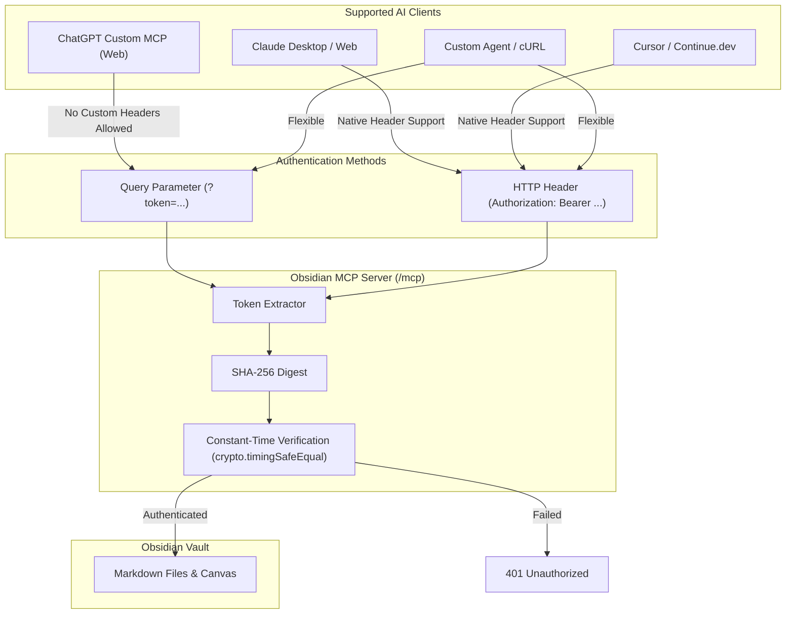

# AI Client Connection & Authentication Guide

The Obsidian MCP Server provides a standardized Model Context Protocol (MCP) interface allowing AI assistants to securely read, search, and manage Obsidian notes. This guide documents how authentication operates across different AI client architectures, including OpenAI ChatGPT, Anthropic Claude, Cursor IDE, and automated agent frameworks.

---

## 1. Authentication Architecture

The server implements a zero-trust credential verification model designed to accommodate varying client capabilities while preserving cryptographic isolation.



### Dual Authentication Protocols

1. **HTTP Authorization Header (Standard RFC 6750)**:
   - Format: `Authorization: Bearer <your-secret-token>`
   - Case-insensitive scheme handling (`Bearer` or `bearer`).
   - Supported by Claude Desktop, Cursor IDE, LibreChat, and terminal tooling.

2. **Query Parameter Token (URL-Embedded Passkey)**:
   - Format: `?token=<your-secret-token>` (or `?auth_token=...` / `?bearer_token=...`)
   - Supported across all endpoints: Streamable HTTP (`/mcp`), Server-Sent Events (`/sse`), and legacy message relays (`/messages`).
   - Specifically engineered for cloud clients like ChatGPT Plugins that do not allow manual configuration of custom request headers.

### Security Guarantees
- **Timing-Safe Evaluation**: All credential checks execute using `crypto.timingSafeEqual` over SHA-256 digests. This prevents side-channel timing analysis attacks regardless of input token length.
- **Fail-Closed Default**: Requests lacking valid credentials immediately return HTTP `401 Unauthorized` without accessing file system resources.
- **CORS Permissiveness**: Preflight `OPTIONS` requests return HTTP `204 No Content` with open origin headers to support web-based client applications.

---

## 2. Connecting ChatGPT (Web / Custom MCP Plugins)

### Understanding the ChatGPT Configuration Dialog
When adding a custom MCP server in ChatGPT (**ChatGPT** &rarr; **Plugins** / **Apps** &rarr; **Add custom MCP server**), the UI presents:
- **Connection**: `Server URL` or `Tunnel`
- **Authentication**: `OAuth`, `No authentication`, or `OAuth or no authentication`

ChatGPT does **not** provide a text field to paste a static API key or `Bearer` token header. ChatGPT expects either a complete OAuth 2.1 identity provider or a direct endpoint without OAuth redirection.

### Step-by-Step Configuration

To connect ChatGPT using your secret token:

#### 1. Set Authentication to "No authentication"
Select **`No authentication`** from the Authentication dropdown. This tells ChatGPT to bypass OAuth discovery and initiate direct communication with the server.

#### 2. Append the Token to the Server URL
Under the **Connection** section, select **`Server URL`** and append `?token=<your-token>` to your public endpoint:

```text
https://<your-public-domain-or-tunnel>/mcp?token=your-secret-token
```

#### 3. Complete Setup in ChatGPT
1. **Name**: `Obsidian Vault`
2. **Description** *(optional)*: `Secure knowledge base connector`
3. **Connection**: Select **`Server URL`**
4. **Server URL**: `https://<your-domain-or-tunnel>/mcp?token=your-secret-token`
5. **Authentication**: Select **`No authentication`**
6. Check **"I understand and want to continue"**
7. Click **Create as a plugin**

### Cloud Networking Requirement
ChatGPT runs in cloud environments. It cannot reach private local addresses like `http://127.0.0.1:9435` or `http://localhost:9435`.
- **For Local Docker (Mac/Linux/Windows)**: Expose port `9435` via a public tunnel:
  ```bash
  ngrok http 9435
  ```
  Then use the generated HTTPS address:
  `https://your-subdomain.ngrok-free.dev/mcp?token=your-secret-token`
- **For VPS Deployments (Ubuntu/Debian)**: Use your public domain secured by reverse proxy TLS:
  `https://mcp.yourdomain.com/mcp?token=your-secret-token`

---

## 3. Connecting Anthropic Claude

### Claude Desktop (Remote HTTP Transport)

Edit your Claude Desktop configuration file:
- **macOS**: `~/Library/Application Support/Claude/claude_desktop_config.json`
- **Windows**: `%APPDATA%\Claude\claude_desktop_config.json`

Add the remote MCP server using the `Authorization` header:

```json
{
  "mcpServers": {
    "obsidian-remote": {
      "url": "https://mcp.yourdomain.com/mcp",
      "headers": {
        "Authorization": "Bearer your-secret-token"
      }
    }
  }
}
```

*(Note: For legacy Claude versions requiring Server-Sent Events, change the URL to `https://mcp.yourdomain.com/sse`).*

### Claude Desktop (Local Subprocess / stdio)

If running the MCP server locally without Docker or HTTP:

```json
{
  "mcpServers": {
    "obsidian-local": {
      "command": "node",
      "args": [
        "/absolute/path/to/obsidian-mcp/dist/index.js",
        "--transport=stdio"
      ],
      "env": {
        "OBSIDIAN_VAULT_PATH": "/path/to/your/obsidian/vault",
        "AUTH_ENABLED": "false"
      }
    }
  }
}
```

---

## 4. Connecting Cursor IDE

1. Open **Cursor Settings** &rarr; **Features** &rarr; **MCP Servers**.
2. Click **Add New MCP Server**.
3. Configure the server:
   - **Name**: `obsidian`
   - **Type**: `SSE` or `HTTP`
   - **URL**: `https://mcp.yourdomain.com/mcp` (or local `http://127.0.0.1:9435/mcp`)
   - **Headers**:
     ```json
     {
       "Authorization": "Bearer your-secret-token"
     }
     ```
4. Save and verify that tools appear with green status indicators in Cursor's MCP inspector.

---

## 5. Connecting Custom Agents, LibreChat, and Open-WebUI

### LibreChat / Open-WebUI / Continue.dev

In multi-client web interfaces supporting MCP HTTP connections, declare the server endpoint and authorization headers:

```yaml
mcpServers:
  obsidian:
    type: streamable-http
    url: "https://mcp.yourdomain.com/mcp"
    headers:
      Authorization: "Bearer your-secret-token"
```

If the client interface does not permit setting custom HTTP headers, provide the URL with query parameters:

```yaml
mcpServers:
  obsidian:
    type: streamable-http
    url: "https://mcp.yourdomain.com/mcp?token=your-secret-token"
```

---

## 6. Verification and Diagnostics

You can test connectivity and authentication directly from your command line:

### 1. Test Without Credentials (Must Return HTTP 401)
```bash
curl -i -X POST http://127.0.0.1:9435/mcp \
  -H "Content-Type: application/json" \
  -d '{"jsonrpc":"2.0","id":1,"method":"tools/list"}'
```
Expected response:
```http
HTTP/1.1 401 Unauthorized
{"error":{"code":"AUTH_REQUIRED","message":"Missing or malformed Authorization header. Expected 'Bearer <token>'."}}
```

### 2. Test with HTTP Authorization Header
```bash
curl -i -X POST http://127.0.0.1:9435/mcp \
  -H "Authorization: Bearer your-secret-token" \
  -H "Content-Type: application/json" \
  -H "Accept: application/json, text/event-stream" \
  -d '{
    "jsonrpc": "2.0",
    "id": 1,
    "method": "initialize",
    "params": {
      "protocolVersion": "2024-11-05",
      "capabilities": {},
      "clientInfo": { "name": "diagnostic-client", "version": "1.0.0" }
    }
  }'
```
Expected response: `HTTP/1.1 200 OK` with session details.

### 3. Test with URL Query Parameter Token
```bash
curl -i -X POST "http://127.0.0.1:9435/mcp?token=your-secret-token" \
  -H "Content-Type: application/json" \
  -H "Accept: application/json, text/event-stream" \
  -d '{
    "jsonrpc": "2.0",
    "id": 1,
    "method": "initialize",
    "params": {
      "protocolVersion": "2024-11-05",
      "capabilities": {},
      "clientInfo": { "name": "diagnostic-client", "version": "1.0.0" }
    }
  }'
```
Expected response: `HTTP/1.1 200 OK` with session details.

---

## 7. Troubleshooting Authentication Issues

| Symptom | Cause | Solution |
| :--- | :--- | :--- |
| `401 Unauthorized: Missing or malformed Authorization header` | Request has no `Authorization` header and no `?token=` parameter. | Ensure `?token=your-token` is appended to the URL or `Authorization: Bearer <token>` is present in headers. |
| `401 Unauthorized: Invalid access token credentials` | The token does not match `AUTH_TOKEN` or `BEARER_TOKEN_HASH`. | Verify that the token string in the client matches the server's environment variable. |
| `Connection Refused` or `Cannot reach host` in ChatGPT | ChatGPT was provided a local address (`127.0.0.1` or `localhost`). | Cloud AI platforms cannot reach your local network. Use a public HTTPS tunnel (e.g., `ngrok http 9435`) or a VPS. |
| `500 Internal Error: BEARER_TOKEN_HASH is not configured` | `AUTH_ENABLED=true` is set, but no token was configured on startup. | Ensure `AUTH_TOKEN=your-token` is defined in Docker or `.env`. |

